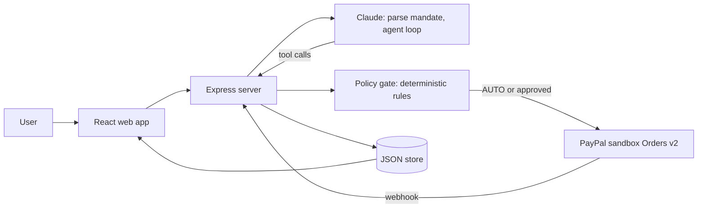

# Architecture

Principle: **the AI suggests, deterministic code enforces.** `server/src/policy` contains no AI calls.

Flow: mandate text -> validated JSON -> agent searches and proposes a cart -> policy returns AUTO / NEEDS_APPROVAL / BLOCKED -> PayPal order created -> buyer approves in sandbox -> capture -> webhook confirms -> audit log updates.
